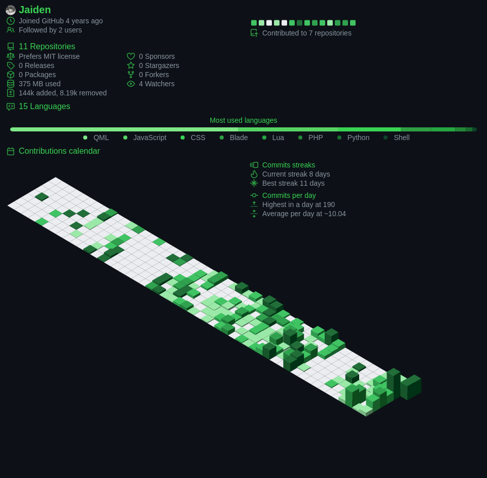

### zilla416

Full stack developer. I build web applications front to back, and I like the problems that take some untangling.

Currently spending time with Linux and newer web tooling.

&nbsp;

**Stack**

&nbsp;

**Projects**

- [**link-gate**](https://github.com/zilla416/link-gate) · URL transfer client over websockets
- [**python-watermarker**](https://github.com/zilla416/python-watermarker) · Fast video watermarking with Python and FFmpeg
- [**javascript-retrogame**](https://github.com/zilla416/javascript-retrogame) · A retro game in plain JavaScript

&nbsp;

