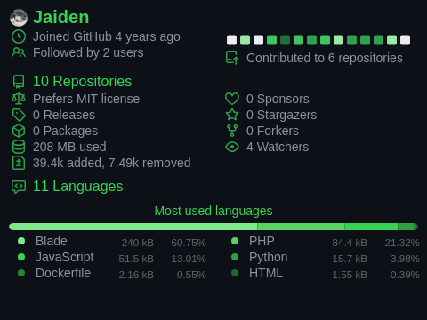
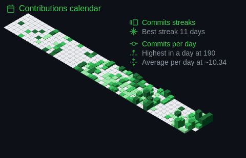

### zilla416

Full stack developer. I build web applications front to back, and I like the problems that take some untangling.

Currently spending time with Linux and newer web tooling.

&nbsp;

&nbsp;

